 

### `$ cat about.md`

- 🛠️ I build tools for things that annoy me, then keep polishing them long after they work. 
  遇到麻煩事就自己寫工具解決，然後忍不住一直打磨下去。
- 📱 Currently into on-device AI on Android, Chrome extensions, and anything that can be automated. 
  最近在玩 Android 端側 AI、Chrome 擴充功能，以及所有能自動化的東西。
- 📖 Learning Japanese by reading manga, which is how [Mangayaku](https://github.com/ChiuKuanHsun/Mangayaku) happened. 
  靠看漫畫學日文，Mangayaku 就是這樣來的。
- 🎓 Student at National Tsing Hua University, Taiwan. 
  就讀於國立清華大學。

### `$ ls ~/projects --sort=stars`

| Project | What it does | Built with |
| :-- | :-- | :-- |
| **[Mangayaku](https://github.com/ChiuKuanHsun/Mangayaku)**  | Android overlay that translates Japanese manga in place. Bubble detection and OCR run on the phone, with JLPT-aware vocabulary notes. 在任何閱讀器上即時翻譯日文漫畫的 Android 懸浮工具，辨識完全在手機上執行。 | Kotlin · Jetpack Compose · ONNX Runtime |
| **[Tab Prettier](https://github.com/ChiuKuanHsun/Tab-prettier)**  | Chrome new tab page that composes scenery, an anime character and a clock into one layered scene that shifts with your mouse. [Chrome Web Store →](https://chromewebstore.google.com/detail/fnacfhfopcdcgidgjllgngoigaajbapi) 把新分頁變成有景深的動漫場景，滑鼠一動畫面就跟著動。 | TypeScript · Manifest V3 |
| **[Intent-Based Phishing Detector](https://github.com/ChiuKuanHsun/LLM-And-CyberSecurity-Project)** | Chrome extension that uses an LLM to read the social-engineering intent behind a page's text and flag phishing. 用 LLM 分析網頁文字背後的社交工程意圖，偵測釣魚攻擊。 | JavaScript · Python · LLM |
| **[cookierun-auto-run](https://github.com/ChiuKuanHsun/cookierun-auto-run)** | Low-latency auto-runner for an Android emulator: writes touch events straight to the input device over ADB, no root. 透過 ADB 直接寫入觸控事件的低延遲自動掛機工具，不需要 root。 | Python · ADB |
| **[BahaItemAutoNotify](https://github.com/ChiuKuanHsun/BahaItemAutoNotify)** | Watches the Bahamut reward shop and pushes new or changed items to Discord, running on a phone under Termux. 監看巴哈勇者福利社，新上架或異動就推播到 Discord，部署在手機 Termux 上。 | Python · Discord |
| **[cpp26-reflection-demos](https://github.com/ChiuKuanHsun/cpp26-reflection-demos)** | C++26 static reflection (P2996) examples with compile-time measurements. C++26 靜態反射範例與編譯時間實測。 | C++26 |

### `$ cat stack.json`

 

 

### `$ langs --top 6`

### `$ ./snake --eat contributions`

<picture>
  <source media="(prefers-color-scheme: dark)" srcset="https://raw.githubusercontent.com/ChiuKuanHsun/ChiuKuanHsun/output/snake-dark.svg" />
  
</picture>

### `$ ping kuanhsun`

The cards above are generated by <a href="./scripts/generate.py"><code>scripts/generate.py</code></a> and refreshed daily by GitHub Actions. 上面的卡片由腳本產生，每天由 GitHub Actions 自動更新。
