<a href="./README.md">English</a> &nbsp;·&nbsp; <b>繁體中文</b>

 

### `$ cat about.md`

&nbsp; 遇到麻煩事就自己寫工具解決，然後忍不住一直打磨下去。

&nbsp; 最近在玩 Android 端側 AI、Chrome 擴充功能，以及所有能自動化的東西。

&nbsp; 靠看漫畫學日文，<a href="https://github.com/ChiuKuanHsun/Mangayaku">Mangayaku</a> 就是這樣來的。

&nbsp; 就讀於國立清華大學。

### `$ ls ~/projects --sort=stars`

| 專案 | 內容 | 技術 |
| :-- | :-- | :-- |
| **[Mangayaku](https://github.com/ChiuKuanHsun/Mangayaku)**  | 在任何閱讀器上即時翻譯日文漫畫的 Android 懸浮工具，辨識完全在手機上執行。 | Kotlin · Jetpack Compose · ONNX Runtime |
| **[Tab Prettier](https://github.com/ChiuKuanHsun/Tab-prettier)**  | 把新分頁變成有景深的動漫場景，滑鼠一動畫面就跟著動。 [Chrome Web Store →](https://chromewebstore.google.com/detail/fnacfhfopcdcgidgjllgngoigaajbapi) | TypeScript · Manifest V3 |
| **[NTHU Chatbot](https://github.com/NTHU-SA/NTHU-Chatbot)**  | 清華大學學生會的校園 LINE Bot「清華校園情報員」：用指令查公車、餐廳、圖書館與公告，也能在 LIFF 網頁和串接 NTHU Data MCP 的 AI 助理對話。 | Python · FastAPI · LINE API · OpenAI Agents SDK · Firestore · Cloud Run |
| **[Intent-Based Phishing Detector](https://github.com/ChiuKuanHsun/LLM-And-CyberSecurity-Project)** | 用 LLM 分析網頁文字背後的社交工程意圖，偵測釣魚攻擊。 | JavaScript · Python · LLM |
| **[cookierun-auto-run](https://github.com/ChiuKuanHsun/cookierun-auto-run)** | 透過 ADB 直接寫入觸控事件的低延遲自動掛機工具，不需要 root。 | Python · ADB |
| **[BahaItemAutoNotify](https://github.com/ChiuKuanHsun/BahaItemAutoNotify)** | 監看巴哈勇者福利社，新上架或異動就推播到 Discord，部署在手機 Termux 上。 | Python · Discord |
| **[cpp26-reflection-demos](https://github.com/ChiuKuanHsun/cpp26-reflection-demos)** | C++26 靜態反射範例與編譯時間實測。 | C++26 |

### `$ cat stack.json`

 

 

### `$ langs --top 6`

### `$ ./snake --eat contributions`

<picture>
  <source media="(prefers-color-scheme: dark)" srcset="https://raw.githubusercontent.com/ChiuKuanHsun/ChiuKuanHsun/output/snake-dark.svg" />
  
</picture>

### `$ ping kuanhsun`

上面的卡片由 <a href="./scripts/generate.py"><code>scripts/generate.py</code></a> 產生，每天由 GitHub Actions 自動更新。
